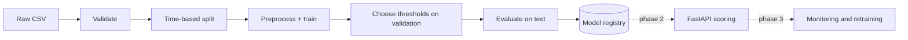

# Credit Card Fraud Detection

End-to-end fraud detection system: a reproducible training pipeline that compares classical and boosted models, chooses decision thresholds from business costs, and turns scores into approve / review / block actions.

[](https://github.com/Ohm-Kel/credit-card-fraud-detection/actions/workflows/ci.yml)
[](LICENSE)
[](pyproject.toml)

## Problem and solution

Card fraud is rare (about 0.17% of transactions in this dataset) but expensive. A model that predicts "not fraud" for everything is 99.8% accurate and useless, so this project is built around the questions a bank actually asks:

- **Does the model rank fraud above legitimate transactions?** Measured with PR-AUC, not accuracy.
- **Where should the alert threshold sit?** Chosen by minimising the cost of missed fraud plus analyst reviews, not by defaulting to 0.5.
- **What happens to each transaction?** Two thresholds map every score to approve, manual review or automatic block.
- **Can every result be reproduced and audited?** Fixed seeds, versioned data hash, saved config and git commit with every model.

## Features

- Schema and quality validation that reports every problem at once
- Time-ordered train / validation / test split to avoid leaking future information
- One scikit-learn pipeline per model, so preprocessing is identical in training and serving
- Logistic regression, RBF SVM and XGBoost, with class imbalance handled inside each model
- Cost-based review threshold and precision-targeted block threshold, chosen on validation only
- Versioned model artifacts with metadata (metrics, thresholds, config, data hash, commit)

## Architecture



Full design, requirements and phases: [docs/architecture.md](docs/architecture.md). Key decisions are recorded as ADRs in [docs/adr](docs/adr).

## Tech stack

Python 3.12+, pandas, NumPy, scikit-learn, XGBoost, pytest, Ruff, GitHub Actions.

## Getting started

### Prerequisites

- Python 3.12 or later
- macOS: `brew install libomp` (needed by XGBoost)
- The dataset: download `creditcard.csv` from [Kaggle](https://www.kaggle.com/datasets/mlg-ulb/creditcardfraud) and place it in `data/`

### Installation

```bash
git clone https://github.com/Ohm-Kel/credit-card-fraud-detection.git
cd credit-card-fraud-detection
python3.12 -m venv .venv
source .venv/bin/activate
pip install -e ".[dev]"
pre-commit install
```

### Environment variables

See `.env.example`. The dataset path can also be set in `configs/train.yaml` or passed with `--data`.

### Running locally

```bash
fraud-train --config configs/train.yaml                     # all models
fraud-train --config configs/train.yaml --models xgboost    # one model
```

Outputs:

- `models/<model>/<version>/` with `model.joblib` and `metadata.json`
- `reports/metrics.json` (full results) and `reports/results.md` (summary table)

### Running tests

```bash
pytest
ruff check . && ruff format --check .
```

Tests run on synthetic data with the same schema as the real dataset, so CI never needs the Kaggle file.

## Evaluation results

Held-out test set (the last 20% of transactions in time). Thresholds were chosen on the validation set and then frozen.

_Results will be added after the first full training run._

## Project structure

```
├── configs/train.yaml          # all training settings
├── docs/                       # architecture and ADRs
├── notebooks/                  # exploration only
├── src/fraud_detection/
│   ├── data/                   # load, validate, time-based split
│   ├── features/               # preprocessing pipeline
│   ├── models/                 # model factory and registry
│   ├── evaluation/             # metrics and cost-based thresholds
│   └── pipeline.py             # end-to-end training entry point
└── tests/                      # pytest suite on synthetic data
```

## Limitations

- Features V1 to V28 are anonymised PCA components, so domain feature engineering (merchant, country, device) is not possible.
- There is no card or customer ID, so behavioural features such as transaction velocity cannot be built.
- The data covers two days in September 2013; fraud patterns drift over time, so production use would need monitoring and regular retraining.

## Roadmap

- [x] Phase 1: validated, reproducible training pipeline with cost-based thresholds
- [ ] Keras neural network and model comparison
- [ ] SHAP explanations (global and per transaction)
- [ ] MLflow experiment tracking
- [ ] Phase 2: FastAPI scoring service, Docker, health checks
- [ ] Phase 3: prediction logging, drift monitoring, retraining trigger

## Contributors

Semanu Kwaku Sebuava: design, implementation and evaluation.

## License

MIT, see [LICENSE](LICENSE). Dataset by the Machine Learning Group of ULB, distributed on Kaggle under the Open Database License.
