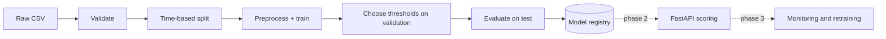

# Credit Card Fraud Detection

End-to-end fraud detection system: a reproducible training pipeline that compares classical and boosted models, chooses decision thresholds from business costs, and turns scores into approve / review / block actions.

[](https://github.com/Ohm-Kel/credit-card-fraud-detection/actions/workflows/ci.yml)
[](LICENSE)
[](pyproject.toml)

## Problem and solution

Card fraud is rare (about 0.17% of transactions in this dataset) but expensive. A model that predicts "not fraud" for everything is 99.8% accurate and useless, so this project is built around the questions a bank actually asks:

- **Does the model rank fraud above legitimate transactions?** Measured with PR-AUC, not accuracy.
- **Where should the alert threshold sit?** Chosen by minimising the cost of missed fraud plus analyst reviews, not by defaulting to 0.5.
- **What happens to each transaction?** Two thresholds map every score to approve, manual review or automatic block.
- **Can every result be reproduced and audited?** Fixed seeds, versioned data hash, saved config and git commit with every model.

## Features

- Schema and quality validation that reports every problem at once
- Time-ordered train / validation / test split to avoid leaking future information
- One scikit-learn pipeline per model, so preprocessing is identical in training and serving
- Logistic regression, RBF SVM, XGBoost and a Keras neural network, with class imbalance handled inside each model
- Cost-based review threshold and precision-targeted block threshold, chosen on validation only
- Versioned model artifacts with metadata (metrics, thresholds, config, data hash, commit)
- SHAP explanations: global feature importance and the top reasons behind each alert

## Architecture



Full design, requirements and phases: [docs/architecture.md](docs/architecture.md). Key decisions are recorded as ADRs in [docs/adr](docs/adr).

## Tech stack

Python 3.12+, pandas, NumPy, scikit-learn, XGBoost, TensorFlow / Keras, SHAP, pytest, Ruff, GitHub Actions.

## Getting started

### Prerequisites

- Python 3.12 or later
- macOS: `brew install libomp` (needed by XGBoost)
- The dataset: download `creditcard.csv` from [Kaggle](https://www.kaggle.com/datasets/mlg-ulb/creditcardfraud) and place it in `data/`

### Installation

```bash
git clone https://github.com/Ohm-Kel/credit-card-fraud-detection.git
cd credit-card-fraud-detection
python3.12 -m venv .venv
source .venv/bin/activate
pip install -e ".[dev,dl,explain]"   # dl = TensorFlow for the Keras model, explain = SHAP
pre-commit install
```

### Environment variables

See `.env.example`. The dataset path can also be set in `configs/train.yaml` or passed with `--data`.

### Running locally

```bash
fraud-train --config configs/train.yaml                     # all models
fraud-train --config configs/train.yaml --models xgboost    # one model
```

Explain a trained model (latest saved version) with SHAP:

```bash
fraud-explain --model xgboost
```

Outputs:

- `models/<model>/<version>/` with `model.joblib` and `metadata.json`
- `reports/metrics.json` (full results) and `reports/results.md` (summary table)
- `reports/explanations/<model>.json` (global importance and reasons for the top alerts) and `<model>_importance.png`

### Running tests

```bash
pytest
ruff check . && ruff format --check .
```

Tests run on synthetic data with the same schema as the real dataset, so CI never needs the Kaggle file.

## Evaluation results

Held-out test set: the last 20% of transactions in time (56,962 transactions, 75 frauds). Thresholds were chosen on the validation set and then frozen. Costs assume 5 per analyst review and at least 10 per missed fraud.

| Model | Val PR-AUC | Test PR-AUC | Test ROC-AUC | Recall | Precision | Alerts | Fraud amount caught | Cost | Saving vs no model |
|---|---|---|---|---|---|---|---|---|---|
| XGBoost | 0.778 | **0.795** | 0.978 | 0.760 | 0.781 | 73 | 65.9% | 3,061 | 62.2% |
| Keras MLP | 0.750 | **0.795** | 0.971 | **0.773** | 0.817 | 71 | 65.9% | 3,041 | 62.4% |
| RBF SVM (tuned, C=10, gamma=0.001) | 0.759 | 0.791 | 0.938 | 0.760 | 0.770 | 74 | **68.9%** | **2,839** | **64.9%** |
| Logistic regression | 0.753 | 0.747 | 0.981 | 0.693 | **0.812** | 64 | 61.1% | 3,401 | 57.9% |

**Findings**

- XGBoost and the Keras network tie on ranking quality (PR-AUC 0.795); the network has the best recall with fewer alerts, and the tuned SVM has the lowest business cost at its chosen threshold. Better overall ranking does not guarantee lower cost at a single operating point, and with 75 test frauds the gap between them is within noise.
- **SVM fix ([ADR 0005](docs/adr/0005-svm-imbalance.md)).** The first SVM scored 0.975 ROC-AUC but only 0.206 PR-AUC, with 469 alerts at 11.9% precision. Class imbalance was corrected twice (undersampling plus balanced class weights) and `C` and `gamma` were untuned. Removing the class weights and tuning on validation PR-AUC raised test PR-AUC to 0.791, cut alerts to 74 and lowered cost from 4,746 to 2,839.
- This is why PR-AUC is the headline metric: ROC-AUC barely moved between the broken and fixed SVM, because it is diluted by tens of thousands of easy true negatives.
- **Keras network ([ADR 0006](docs/adr/0006-keras-mlp.md)).** Early stopping ended training after 14 epochs. Its holdout PR-AUC (0.886, the end of the training period) was well above its validation PR-AUC (0.750, a later period): fraud patterns shift over time and there are few frauds per period, which is why an untouched, later validation set is kept for thresholds.
- The best SVM setting sits at the edge of the search grid, so a wider grid may improve it further.
- Logistic regression and XGBoost gave identical results across runs, confirming the pipeline is reproducible with a fixed seed.
- With 75 test frauds, one fraud is worth about 1.3 points of recall.
- Fraud is unevenly spread over time (360 / 57 / 75 frauds across train / validation / test), which a random split would hide.
- The data contains 1,081 duplicated rows, kept for now; whether they are genuine repeat transactions is an open question.

Reproduce with `fraud-train --config configs/train.yaml` (seed 42).

### Explainability (SHAP, XGBoost)

Global importance on all test frauds plus 500 legitimate test transactions, from `fraud-explain --model xgboost` (exact tree explainer, log-odds):

1. V14 and V4 dominate (mean |SHAP| about 1.7 and 1.6), followed by V12 (1.1) and V10 (0.85).
2. Amount ranks 9th (about 0.35): transaction size helps, but far less than the leading components.
3. Time of day is outside the top 15: over two days of data it adds little once other features are known.

Because V1 to V28 are anonymised PCA components, the explanations show which components drive a score but cannot be translated into business terms such as merchant or country. With raw features, the same `top_reasons` output would give analysts directly actionable reasons for each alert.

## Project structure

```
├── configs/train.yaml          # all training settings
├── docs/                       # architecture and ADRs
├── notebooks/                  # exploration only
├── src/fraud_detection/
│   ├── data/                   # load, validate, time-based split
│   ├── features/               # preprocessing pipeline
│   ├── models/                 # model factory and registry
│   ├── evaluation/             # metrics and cost-based thresholds
│   └── pipeline.py             # end-to-end training entry point
└── tests/                      # pytest suite on synthetic data
```

## Limitations

- Features V1 to V28 are anonymised PCA components, so domain feature engineering (merchant, country, device) is not possible.
- There is no card or customer ID, so behavioural features such as transaction velocity cannot be built.
- The data covers two days in September 2013; fraud patterns drift over time, so production use would need monitoring and regular retraining.

## Roadmap

- [x] Phase 1: validated, reproducible training pipeline with cost-based thresholds
- [x] Investigate and fix the SVM (single imbalance correction, tuned C and gamma)
- [ ] Widen the SVM search grid (best setting is at the edge)
- [x] Keras neural network and model comparison
- [x] SHAP explanations (global and per transaction)
- [ ] MLflow experiment tracking
- [ ] Phase 2: FastAPI scoring service, Docker, health checks
- [ ] Phase 3: prediction logging, drift monitoring, retraining trigger

## Contributors

Semanu Kwaku Sebuava: design, implementation and evaluation.

## License

MIT, see [LICENSE](LICENSE). Dataset by the Machine Learning Group of ULB, distributed on Kaggle under the Open Database License.
