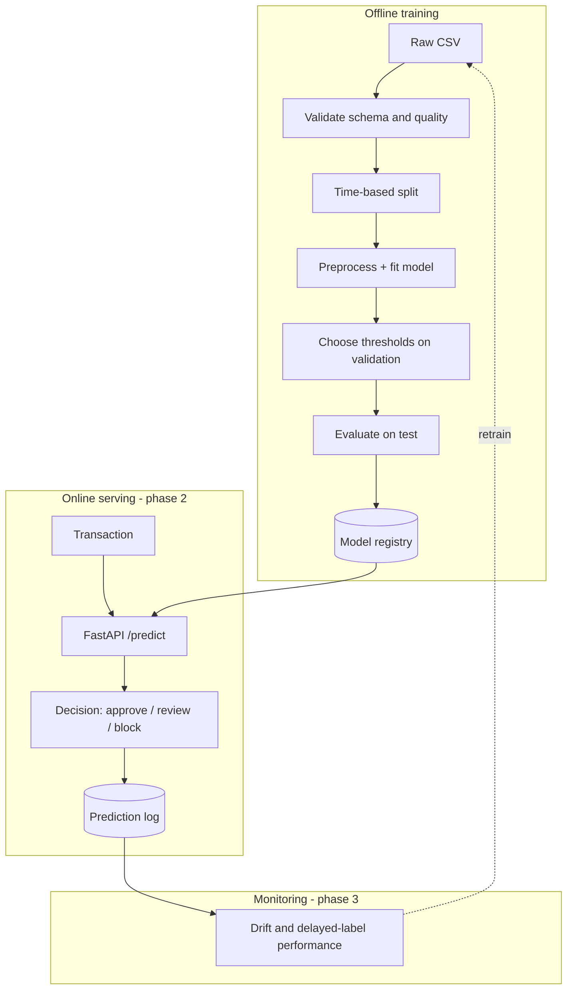

# Architecture

## Goal

Score every card transaction with a fraud probability and turn it into an action (approve,
send to manual review, or block) in a way that is accurate on rare events, cheap for the
business, explainable and reproducible.

## Requirements

### Functional

- Score each transaction with a fraud probability.
- Map the score to approve / review / block with thresholds tied to business costs.
- Explain the main drivers of a score with SHAP (global importance and per-transaction reasons).
- Retrain when new labelled data arrives (planned).

### Non-functional

| Requirement | Target |
|---|---|
| Ranking quality | Maximise PR-AUC on a time-ordered held-out set |
| Decision quality | Minimise expected cost = missed fraud amount + review cost per alert |
| Latency (serving, phase 2) | Under 100 ms per request |
| Reproducibility | Fixed seeds, data hash, config and git commit stored with each model |
| Auditability | Every model artifact carries its metrics and thresholds |

### Constraints from the data

- About 0.17% of transactions are fraud (492 of 284,807).
- V1 to V28 are anonymised PCA components; only `Time` and `Amount` are interpretable.
- No card or customer ID, so behavioural features (velocity, history) are impossible.
- In production, fraud labels arrive weeks later (chargebacks), and patterns drift.

## System overview



## Components

| Component | Module | Responsibility |
|---|---|---|
| Loading | `data/load.py` | Read the CSV, fingerprint it with SHA-256 |
| Validation | `data/validate.py` | Schema, types, nulls, binary target, non-negative amounts |
| Split | `data/split.py` | Time-ordered train / validation / test (60 / 20 / 20) |
| Features | `features/build.py` | Cyclical time of day, log-scaled amount, scaled PCA features |
| Models | `models/factory.py`, `models/keras_mlp.py` | Logistic regression, calibrated RBF SVM, XGBoost, Keras MLP |
| Registry | `models/registry.py` | Versioned artifacts with metadata |
| Metrics | `evaluation/metrics.py` | PR-AUC, ROC-AUC, confusion counts, fraud amount caught |
| Explanations | `evaluation/explain.py`, `explain_cli.py` | SHAP global importance and per-transaction reasons |
| Thresholds | `evaluation/threshold.py` | Cost-optimal review threshold, precision-targeted block threshold |
| Orchestration | `pipeline.py` | End-to-end run and reports |

## Decision policy

```
score >= block_threshold                     -> block
review_threshold <= score < block_threshold  -> manual review
score < review_threshold                     -> approve
```

- The review threshold minimises expected cost on the validation set.
- The block threshold is the lowest threshold whose alerts reach the precision target
  (90% by default). If none does, nothing is blocked automatically.

## Phases

| Phase | Scope | Status |
|---|---|---|
| 1 | Validated, reproducible training pipeline, cost-based thresholds, tests, CI | Done |
| 1b | Keras neural network, SHAP explanations, MLflow tracking | Next |
| 2 | FastAPI scoring service, Pydantic schemas, Docker, health check | Planned |
| 3 | Prediction logging, drift monitoring (PSI), delayed labels, retraining trigger | Planned |

## Decisions

- [ADR 0001: Time-based split](adr/0001-time-based-split.md)
- [ADR 0002: Single pipeline artifact](adr/0002-single-pipeline-artifact.md)
- [ADR 0003: Metrics and cost-based thresholds](adr/0003-metrics-and-thresholds.md)
- [ADR 0004: Model selection and class imbalance](adr/0004-model-selection.md)
- [ADR 0005: SVM imbalance handling and tuning](adr/0005-svm-imbalance.md)
- [ADR 0006: Keras neural network as a scikit-learn estimator](adr/0006-keras-mlp.md)
- [ADR 0007: SHAP explanations](adr/0007-shap.md)
